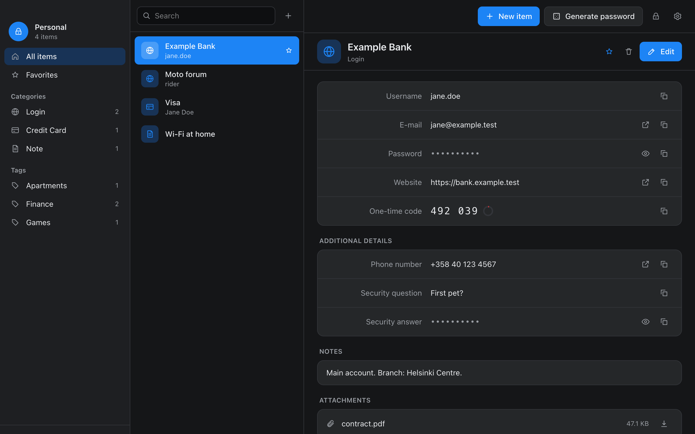
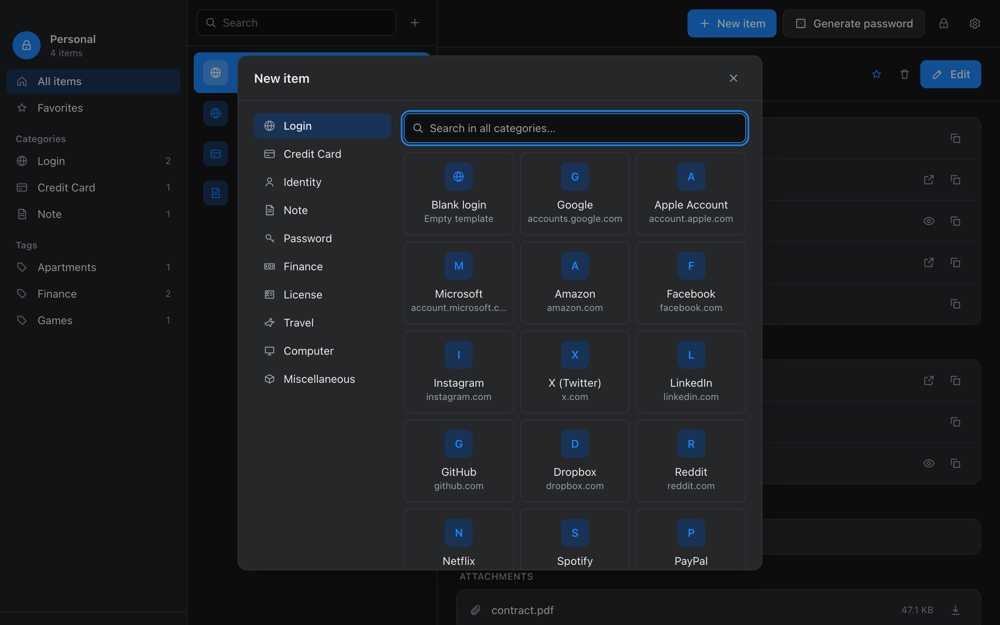
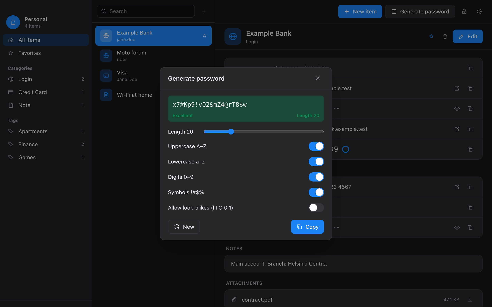
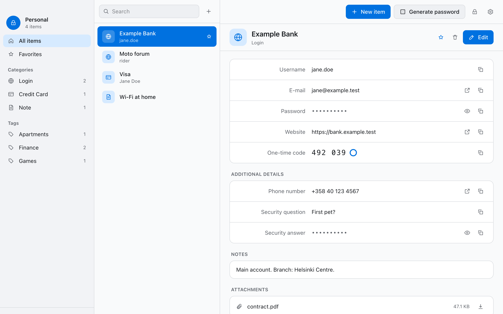

# Vault Manager

> [!NOTE]
> If you've stumbled on this repository by accident: this is a personal hobby project of mine. I
> wanted a comfortable, well-organised password manager, but with my passwords in an open format
> that any KeePass app can read. Vault Manager is a thin interface built on Tauri over standard
> KeePass (KDBX 4) files. I've shared it here for my friends, but if you happen to like it, feel
> free to use it. No guarantees or support of any kind, though: as I said, this is a hobby project.

A password manager for your desktop that keeps your passwords in a standard KeePass file, with items
organised into sections, typed fields and templates. KeePassXC, KeePassium, Strongbox and other
KeePass apps can open the same file.

## Install

Get the latest version from
[Releases](https://github.com/artti-jaakkola/vault-manager-releases/releases/latest), where each
version lists what's new.

**macOS:** open the `.dmg` and drag Vault Manager to Applications. The app is not signed with an
Apple Developer ID, so macOS blocks the first launch: open System Settings → Privacy & Security and
choose **Open Anyway**.

## Features

**Organised items**
- Named sections and 22 field types: password, PIN, one-time code, card number, CVC, e-mail,
  website, phone, security question and answer, and more
- Any field can be marked sensitive; fields and sections in any order
- Templates for each category, and logins for common sites with the title and website filled in
- Password generator with a strength rating

**Using your items**
- Copy, reveal and open links (web, e-mail, phone) for each field
- Live one-time codes with a countdown
- Search across titles, tags and the non-secret fields; secrets are never searched
- Favourites, tags, folders and attachments

**Your data**
- Standard KeePass KDBX 4 files (Argon2id key derivation), unlocked with a master password and/or a
  key file
- Optional Google Drive sync: an encrypted copy of the vault in your Drive, with changes from each
  device merged item by item
- Recycle bin and the history of earlier versions of each item

**Safety**
- Touch ID unlock on macOS
- Locks itself after a chosen idle time
- Copied passwords are cleared from the clipboard after a chosen time
- Secret values stay in the app's native core and never pass through its web view

## Screenshots

Creating an item from a template, or a login for a common site:

The password generator, with the strength of the passwords it makes:

Light theme:

## Privacy

Vault Manager has no servers, accounts, analytics or tracking. Your vault stays on your computer,
and, if you turn on Google Drive sync, in your own Google Drive, encrypted with your master password.
See the [privacy policy](privacy.md).
